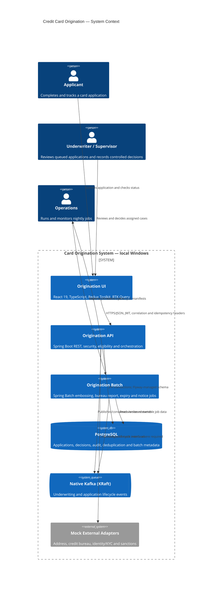
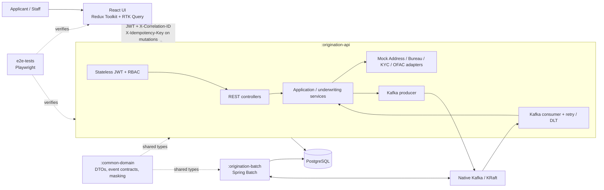
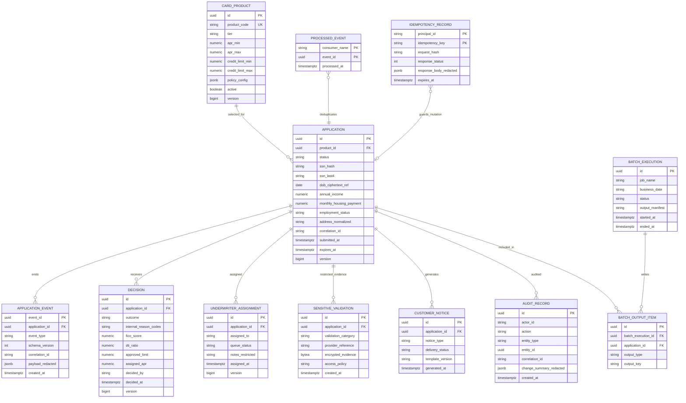
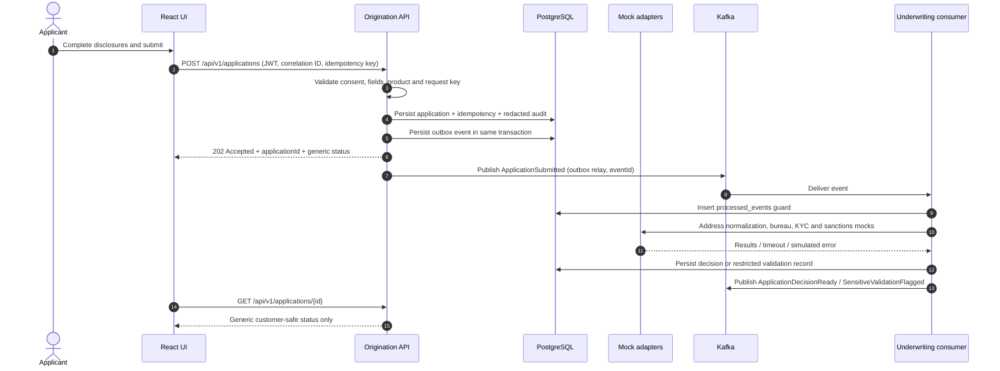
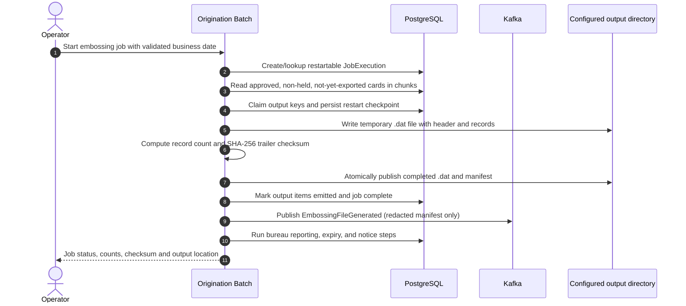

# Bank Credit Card Origination System Architecture

**Status:** Proposed — pending business and architecture sign-off  
**Scope:** Local Windows-first implementation; no containers  
**Decision baseline:** Phase 1 interview answers and explicitly labeled working assumptions

## 1. Goals and assumptions

Build a modular credit-card application system with a React 19/TypeScript customer experience, Spring Boot REST API, asynchronous eligibility processing over native Kafka, PostgreSQL persistence, a Spring Batch operations module, and a Playwright end-to-end suite. The system is a demonstrator, not a production credit decision service: all thresholds, rates, fee schedules, legal notices, data retention, and operational procedures require compliance, fair-lending, legal, security, and product-owner approval before real use.

The applicant supplies identity (SSN and DOB), contact/address, income, housing payment, employment, and required consents. The system stores only an SSN hash (SHA-256 with a secret salt) and `ssn_last4` in the application record. Raw SSN/DOB are transient inputs to mock verification only; if an external validation case needs evidence, that evidence is stored separately in a restricted, encrypted sensitive-validation record with access auditing and retention controls. Raw PII must never appear in application events, ordinary logs, error responses, or customer-facing status.

If identity/KYC, sanctions, address, or a mock external service raises a sensitive validation issue, flag the application for restricted handling and show only: “Sorry, we ran into an issue while processing your application. Please call customer service at 1-800-XXX-XXXX.” Never expose the underlying reason through the UI or public API. A customer-facing decline is likewise generic; detailed adverse-action reasons are retained in restricted decision/audit data and selected for customer communication by the notice batch, subject to legal approval.

All numerical product and underwriting values below are initial assumptions for deterministic local testing, not approved lending policy. Tiers are illustrative and configurable.

### 1.1 Illustrative product assumptions

| Product | Eligibility starting point | APR assumption | Fees and rewards assumption | Initial line assumption |
|---|---|---|---|---|
| Secured | Score 550+ or thin-file review; refundable security deposit required | 24.99% variable | $0 annual fee; no rewards; deposit equals line | $200–$2,000, capped at verified deposit |
| Cashback | Score 660+ and DTI no more than 43% | 19.99%–29.99% variable, assigned by score tier | $0 annual fee; 1.5% eligible net purchases | $500–$15,000 |
| Travel Rewards | Score 720+ and DTI no more than 36% | 17.99%–27.99% variable, assigned by score tier | Assumed $95 annual fee; 2 points per eligible travel dollar, 1 point otherwise | $2,000–$25,000 |

Assume line assignment uses a configurable income multiplier less existing monthly debt and housing burden, then applies product bounds and affordability checks. APR uses configurable score bands. The exact formula, rounding, credit-line increments, secured-deposit workflow, variable-rate index/margin, and fee/reward terms must be approved before implementation.

### 1.2 Illustrative decision policy assumptions

| Outcome | Initial deterministic routing assumption |
|---|---|
| Auto-approve | Product minimum score met, DTI within its cap, identity/address cleared, no disqualifying derogatory marker, and affordability checks pass |
| Manual review | Thin file, borderline score (within 20 points below product minimum), DTI within 5 percentage points above product cap, conflicting/non-fraud identity evidence, or configured low-confidence adapter result |
| Decline | Score more than 20 points below product minimum, DTI more than 5 points above cap, verified disqualifying derogatory marker, or failed affordability rule |
| Sensitive validation hold | Suspected fraud, sanctions potential match, identity mismatch, invalid/unverifiable address, or sensitive adapter failure; no automatic credit decision until restricted review |

Illustrative product FICO floors: Secured 550; Cashback 660; Travel Rewards 720. Illustrative DTI caps: Secured 50%, Cashback 43%, Travel Rewards 36%. These boundaries and reason-code precedence are configurable and must be reviewed for fair-lending and adverse-action compliance. An “auto-approve” is a demo outcome only.

### 1.3 Other working assumptions

- Underwriter roles: `UNDERWRITER`, `UNDERWRITER_SUPERVISOR`, and read-only `AUDITOR`; customer and operations roles are separate. A reviewer can claim/reassign a case, view only the minimum permitted data, record notes, and approve/decline with reason codes. Sensitive cases require supervisor access and a recorded justification. A reviewer cannot approve their own override; maker-checker approval is required for policy overrides and any sensitive-case release.
- Nightly batch jobs: (1) create an embossing `.dat` file for approved, activated, non-held accounts not previously emitted; (2) prepare bureau reporting records; (3) expire stale pending applications after an assumed 30 days; and (4) generate customer adverse-action notices from retained decision reasons. Jobs use configurable business date/time zone, restartable steps, durable checkpoints, idempotent output keys, validated header/trailer counts and SHA-256 checksums. Batch emits files to a configured local output directory; no real bureau or card processor is contacted.
- External mock adapters support configurable latency, timeout, and failure rates. Named deterministic fixture personas are used in automated tests for prime, thin-file, fraud alert, identity mismatch, sanctions potential match, invalid address, and adapter failures. Fixture SSN/DOB values are generated synthetic-only, kept in test configuration, and must never be copied from real people.
- Customer status is generic and does not disclose decision or sensitive-validation reason details. Internal decision codes and explanations are restricted and audit logged. Communications are generated by batch only after required legal/business controls are approved.

## 2. System context and component view



### 2.1 Application component view



### 2.2 Responsibility boundaries

- `:common-domain`: immutable API DTOs, versioned Kafka event contracts, correlation/security constants, public error model, and PII-safe formatting/masking helpers. No persistence entities.
- `:origination-api`: REST controllers, stateless JWT/RBAC, application and decision services, JPA repositories, Flyway migrations, mock adapters, Kafka producer/consumer, idempotency, and outbox/event handling.
- `:origination-batch`: independent Spring Boot/Spring Batch process sharing schema and contracts; restartable embossing, bureau-report file generation, stale-case expiration, and adverse-action notice preparation.
- `origination-ui`: public applicant journey and role-gated staff workbench. Server state uses RTK Query; Redux slices hold transient client workflow state only.
- `e2e-tests`: Playwright API and browser tests against locally running services and synthetic personas.

## 3. Data model and ERD



`dob_ciphertext_ref` is a conceptual encrypted-value reference, not a plain date column: retain DOB only if a documented business/legal purpose requires it, encrypt it with a managed key, restrict access, and set a retention limit. Prefer not to persist raw DOB. `ssn_hash` is a keyed/salted SHA-256 digest using a secret salt outside the database; never use a global hard-coded salt. Store only `ssn_last4` beside the hash. Sensitive provider evidence is encrypted and accessible only to restricted service roles; do not put raw identity data into Kafka, normal audit summaries, or log messages.

Indexes and integrity controls:

- Unique `card_product.product_code`; partial index on active products.
- `application(status, submitted_at)` for customer and work queues; `application(expires_at)` for expiry; `application(product_id, submitted_at)` for reporting.
- Unique `decision(application_id)` for the current final decision, plus history semantics (append-only records) if multiple decision attempts are required.
- Unique `(consumer_name, event_id)` on `processed_event`; unique `(principal_id, idempotency_key)` on `idempotency_record`.
- `sensitive_validation(application_id, created_at)` is restricted; avoid indexing sensitive evidence or identifiers.
- `audit_record(entity_type, entity_id, created_at)` and `audit_record(actor_id, created_at)`.
- `batch_execution(job_name, business_date)` and unique `batch_output_item(output_type, output_key)` for restart and duplicate protection.
- JPA `@Version` optimistic locking on mutable application, decision, assignment, product, and batch state. Audit records are append-only and database permissions prevent application-service updates/deletes to audit history.
- Runtime service account has DML-only access to required application tables; separate Flyway owner owns schema and migrations. Fine-grained grants deny access to sensitive tables except the restricted service path.

## 4. Submission and asynchronous underwriting



The API requires `X-Idempotency-Key` on every POST mutation. Scope keys by authenticated principal and endpoint, bind them to a canonical request hash, and reject reuse with a different payload. Persist the response identity/result to support safe retries. `X-Correlation-ID` is accepted only after validation or generated by the API; return it on every response, place it in MDC, persist it on audit/outbox records, and propagate it as a Kafka header. Do not treat either header as authorization.

Kafka events use a transactional outbox to avoid a database-commit/event-publish gap. Producers set `acks=all` and `enable.idempotence=true`. Consumers insert `(consumer_name,event_id)` into `processed_events` transactionally with their business update. Retry transient errors with bounded exponential backoff and route exhausted events to a DLT; DLT payloads remain PII-free and require operational review/replay.

## 5. Manual review and approval

```mermaid
sequenceDiagram
    autonumber
    actor Underwriter
    actor Supervisor
    participant UI as Staff UI
    participant API as Origination API
    participant DB as PostgreSQL
    participant Kafka
    Underwriter->>UI: Open assigned manual-review queue
    UI->>API: GET /api/v1/workbench/applications?status=MANUAL_REVIEW
    API->>DB: Authorize role; load least-privilege view
    API-->>UI: Redacted applicant and internal review data
    Underwriter->>UI: Record note and proposed approve/decline
    UI->>API: POST decision (idempotency + correlation headers)
    API->>DB: Check role, assignment, policy, version and reason codes
    alt Standard authorized decision
        API->>DB: Persist decision + audit + outbox event atomically
    else Policy override or sensitive-case release
        API-->>UI: Pending supervisor approval
        Supervisor->>UI: Review override and approve/reject
        UI->>API: POST supervisor action (new idempotency key)
        API->>DB: Enforce maker-checker; persist outcome and audit
        API->>Kafka: Publish decision event through outbox
    end
    API-->>UI: Updated internal queue state
    UI->>API: Applicant-facing status endpoint
    API-->>UI: Generic status without adverse-action or sensitive details
```

Underwriter endpoints and response fields are role-scoped. Sensitive validation evidence is not returned by general workbench endpoints; a separate restricted permission and audited workflow is required. All decisions record actor, prior/new state, policy version, reason codes, and correlation ID, without raw PII in audit summaries.

## 6. Nightly embossing batch



Proposed `.dat` layout is fixed-width UTF-8 with CRLF line endings; header contains record type, job ID, business date, and expected count; records contain only processor-required fields; trailer contains count and SHA-256 checksum over data records. Do not include SSN or DOB. PAN is not generated by this system. Exact processor format and delivery encryption/signing requirements must be supplied before implementation. Write to a temporary file and atomically rename only after validation. A rerun for the same business date must resume or produce the same idempotent output keys, never duplicate records. The other batch steps use explicit commit intervals, restartable readers/writers, `SkipPolicy`, and bounded `RetryPolicy`.

## 7. REST API catalog (proposed)

All endpoints are under `/api/v1`; JSON DTOs only (never JPA entities). Every response includes `X-Correlation-ID`. Every POST requires `X-Idempotency-Key`. Errors use RFC 7807 `ProblemDetail` with safe generic `detail` and a traceable correlation identifier; no stack traces, raw adapter errors, SSN, DOB, or internal adverse-action reason in public responses.

| Method and path | Access | Purpose |
|---|---|---|
| `GET /products` | Public | List active products and customer-safe terms |
| `POST /applications` | Applicant | Submit application; returns `202`, application ID and generic status |
| `GET /applications/{applicationId}` | Applicant owner / permitted staff | Return role-safe current status |
| `GET /applications/{applicationId}/events` | Applicant owner / permitted staff | Return sanitized status history |
| `GET /workbench/applications` | Underwriter / Supervisor | Filter and page authorized review queue |
| `POST /workbench/applications/{id}/claim` | Underwriter / Supervisor | Claim or assign review |
| `POST /workbench/applications/{id}/notes` | Underwriter / Supervisor | Add restricted, audited note |
| `POST /workbench/applications/{id}/decisions` | Underwriter / Supervisor | Record decision proposal/result with reason codes |
| `POST /workbench/applications/{id}/overrides/{overrideId}/approval` | Supervisor only | Maker-checker approval or rejection |
| `GET /ops/batch/jobs` | Operations / Auditor | List job executions and safe manifests |
| `POST /ops/batch/jobs/{jobName}/executions` | Operations | Start an allowlisted job with validated parameters |
| `GET /ops/batch/jobs/{executionId}` | Operations / Auditor | Read job status, counts, and sanitized failures |
| `GET /actuator/health` | Restricted operations | Health/readiness without sensitive configuration |

Authentication uses stateless JWT with issuer/audience/signature validation and short-lived tokens; token acquisition is outside this local system scope. Enforce ownership checks, request validation, rate limits, CSRF posture appropriate to bearer-token usage, and least-privilege response DTOs.

## 8. Kafka topics and event contracts

Topic names are versioned and environment-configurable. Each event envelope contains `eventId` (UUID), `eventType`, `schemaVersion`, `occurredAt`, `applicationId`, `correlationId`, and a redacted `data` object. Correlation is duplicated in the Kafka header. Event contracts must not carry raw SSN/DOB, JWTs, address details, or sensitive provider payloads.

| Topic | Producer → consumer | Event data |
|---|---|---|
| `card.application.submitted.v1` | API → underwriting worker | Application ID, product code, policy version, submitted time |
| `card.application.decision-ready.v1` | API/worker → status/notice flow | Application ID, outcome category, decision ID; no detailed reasons |
| `card.application.sensitive-validation.v1` | Worker → restricted queue handler | Application ID, category enum, opaque provider reference only |
| `card.application.expired.v1` | Batch → lifecycle consumers | Application ID, business date |
| `card.embossing.file-generated.v1` | Batch → operations consumers | Job ID, business date, record count, checksum, manifest reference |
| `card.application.underwriting.dlt.v1` | Retry infrastructure → operations | Original event envelope plus safe failure metadata and source topic |

Use schema compatibility checks in tests, explicit partition/key strategy by application ID, bounded retention, and ACLs. DLT replay is an audited operations action, not an automatic unbounded loop.

## 9. RBAC matrix

| Capability | Applicant | Underwriter | Supervisor | Operations | Auditor |
|---|:---:|:---:|:---:|:---:|:---:|
| Browse public products | Yes | Yes | Yes | Yes | Yes |
| Submit application / view own status | Yes | No | No | No | No |
| View assigned review queue / add note | No | Yes | Yes | No | No |
| Record standard decision | No | Yes | Yes | No | No |
| Approve another actor's override | No | No | Yes | No | No |
| Access restricted validation evidence | No | Explicit grant only | Explicit grant only | No | No |
| Start/restart allowlisted batch job | No | No | No | Yes | No |
| View redacted audit/job manifests | No | Scoped | Yes | Scoped | Yes |
| Change policy/product configuration | No | No | Separate privileged role/process | No | No |

All privileged access is authenticated, authorized server-side, least-privilege, audited, and tested for horizontal/vertical access control failures. Test accounts and roles are synthetic and local-only.

## 10. Privacy, security, and reliability controls

- TLS on service boundaries where configured; local development may use loopback but must not weaken production profiles.
- Hash SSN with SHA-256 plus a high-entropy secret salt held outside the database. Keep raw SSN/DOB transient, disable request-body logging, and mask PII in Logback before serialization. Correlation IDs and trace IDs are present in structured logs; never log tokens or sensitive validation details.
- Separate restricted validation evidence from normal application state. Encrypt sensitive columns, use separate grants, audit access, and implement retention/deletion policy. No actual sensitive evidence in test fixtures.
- Validate and normalize all user inputs; use parameterized database access; encode UI output; avoid dynamic HTML rendering.
- Use stateless JWT + RBAC, owner checks, optimistic locking, idempotency keys, transactional outbox, processed-event deduplication, bounded retries, and DLT monitoring.
- Mock adapter timeouts/failure/latency are configuration-driven and deterministic by persona for tests. Circuit-breaker behavior and user-visible generic statuses should avoid leaking provider availability details.
- Health endpoints expose only operationally necessary information. Secrets, DB credentials, JWT keys, and SSN salt are environment variables or externalized configuration; never committed.

## 11. Local Windows topology and implementation sequence

No containers. Local prerequisites are Java 21, Gradle Wrapper, Node.js, portable PostgreSQL binaries (`initdb`, `pg_ctl`), and native Kafka in KRaft mode. PostgreSQL uses a schema owner (`origination_admin`) for Flyway and a distinct least-privilege runtime user (`origination_svc_user`) with DML-only grants. Bootstrap secrets are prompted or loaded from environment variables, not embedded in scripts. Kafka, API, batch, and Vite run as separate local processes.

Proposed build order after this document is approved:

1. Portable PostgreSQL bootstrap and startup scripts, least-privilege roles, and Flyway schema/reference data.
2. Gradle Kotlin DSL multi-project backend (`common-domain`, `origination-api`, `origination-batch`), unit/integration tests, Kafka and Batch test coverage.
3. React 19 + TypeScript + Vite + Tailwind + Redux Toolkit/RTK Query applicant wizard and role-gated workbench.
4. Windows runbook, native Kafka instructions, synthetic test personas, and Playwright API/UI flows.
5. Build and test all modules, start local services, run Playwright, and resolve failures before declaring completion.

## 12. Sign-off checklist

- [ ] Product pricing, rewards, secured deposit, and credit-line formula approved.
- [ ] FICO/DTI boundaries, other underwriting rules, and reason-code precedence approved.
- [ ] Customer-safe generic messaging and adverse-action notice workflow approved by Legal/Compliance.
- [ ] Sensitive validation evidence, retention, access, encryption, and supervisor workflow approved.
- [ ] Batch file format, output security, schedule/time zone, retries, and rerun behavior approved.
- [ ] OpenAPI catalog, event contracts, and RBAC matrix approved.

No application code should be written until this architecture is reviewed and approved.
